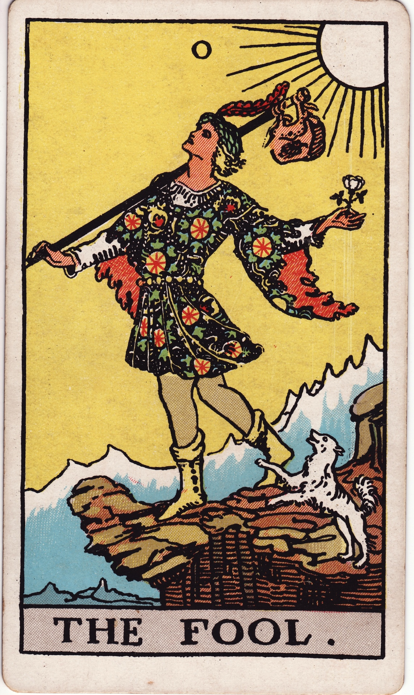

## Trabajo final 
*Seminario de profundización: Tecnociencia y religión (Cristianismo): Antagonismo, convergencia y reinvención*

# Un experimento de escritura

El trabajo final es un ensayo corto que responde a la presentación aleatoria de tres temas de discusión bajo el esquema de situación, acción y resultado. Los temas parten de la obra de la artista británica Suzanne Treister, particularmente del desarrollo del Tarot Hexen 2.0, el cual mezcla la tradición esotérica de interpretación de arcanos con figuras de la sociedad digital contemporánea. Así mismo el esquema de presentación de los temas corresponde a una técnica de lectura del tarot basada en tres cartas. En este caso la técnica se ajusta a un contexto de lectura sociológico mediante la tríada: situación, acción y resultado.

La referencia al tarot como dispositivo de reflexión se fundamenta en dos problemas: Primero, el renacimiento de formas simbólicas asociadas con lo esotérico en la modernidad tardía y su relación con los imaginarios del capitalismo tardío o contemporáneo. Esta conexión es la que anima a Treister a desarrollar el Tarot Hexen. La hiper-racionalidad moderna genera un sistema de explotación que se legitima en el desarrollo de nuevos mitos y una nueva escatología marcada por una esperanza de “arrebatamiento”, de ruptura definitiva con nuestra condición material y carnal, bajo una existencia eterna en la nube. 

Segundo: el judeocristianismo y el Islam se caracterizan por su rechazo viceral al uso de técnicas “advinatorias” o que incluyan al azar como instrumento de premonición o de conocimiento de aquello que está más allá de futuro inmediato. Este rechazo se fundamenta en la idea de la Divina Providencia y en un afán de diferenciación con las religiones del oriente próximo, donde la adivinación y el azar son prácticas comunes. Paradójicamente este rechazo, implicó el desarrollo de una tradición esotérica que se nutre de toda la simbología cristiana bajo un contexto más amplio de interpretación. Tecnologías como la IA generativa pueden ser leídas como máquinas probabilísticas que emanan sentido, oráculos y arcanos.

# Técnica
La clase del próximo 13 de noviembre cada estudiante hace una tirada de cartas con el tarot Hexen.

A partir de la triada: situación, acción y resultado. La idea es escribir un pequeño ensayo que conecte los contenidos presentes en las cartas de Hexen, el contexto interpretativo del Arcano (Guía Tarot elaborada por Natalia Abril) y las lecturas y temas discutidos en clase.

Extensión (500-1000 palabras). 

Fecha de entrega: 27 de noviembre a las 17:00 (Voy a habilitar un Padlet para entrega).

